# Planit API Contract & Data Mapping Specification

## Verified current contract (security checkpoint `cc91433`)

This section is authoritative for Rove Milestone 1. It was checked against
`backend/index.js` and `backend/security.js` after the Phase 2 remediation.
The older audit and proposed TypeScript examples below are retained for historical
context; they describe pre-remediation behavior and must not be copied into a client.
The current mobile TypeScript types are in `rove-mobile/src/types/api.ts`.

| Route | Current request | Current success |
|---|---|---|
| `GET /` | No body or provider call | `200` text health banner. Safe for a connectivity check. |
| `POST /api/reverse-geocode` | JSON `{lat, lng}`; finite numbers or strict numeric strings within latitude `-90..90` and longitude `-180..180` | `200` JSON `{address: string}`. A genuine provider `ZERO_RESULTS` is `404`. |
| `POST /api/itinerary` | JSON with required integer `budget` (`100..10000000`) and nonempty `location` (at most 200 characters). Optional integer `people` (`1..50`, default 2), integer `radius` in meters (`1000..50000`, default 5000), up to four string `filters`, boolean `hasPrivateVehicle` (default false), and `mileage` (`5..60`, default 15). `mileage: null` is accepted only without a private vehicle. | `200` JSON `{itinerary, totalCost, budget, people, aiSummary, warnings?}`. `warnings` is present when optional AI fails but usable nonempty results remain. A genuine Places `ZERO_RESULTS` can yield an empty itinerary. |
| `GET /api/photo?ref=…&maxwidth=…` | `ref` is 10–800 ASCII letters, digits, underscores, hyphens, dots, tildes or plus signs; optional integer `maxwidth` is `100..1600` (default 800) | `200` JPEG/PNG/GIF/WebP bytes, `nosniff`, private five-minute cache. Errors are JSON with `no-store`. |

Current itinerary items use **`place_id`**, not `placeId`. They also include
`name`, optional `address`, nullable `rating`, relative `photoUrl` (or `null`),
`latitude`, `longitude`, `type`, `people`, `travelCost`, `travelTime`, `distance`,
`roundTripDistKm`, `activities`, `aiDescription`, `roughCostPerPerson`,
`description`, `costPerPerson`, `activityCost`, `totalOptionCost`,
`costConfidence`, and `costNote`. `totalCost` currently equals the **first**
option's cost, or zero when there are no options; it is not the sum of all
alternatives. Mobile clients must resolve a relative photo URL against their
configured backend origin. Provider credentials never belong in that URL.

Handled API failures use `{error: string, code: string}` with fixed safe text.
The rate limit middleware can instead return `{error: string}` without `code`.
Relevant statuses are `400` invalid input/JSON, `403` rejected browser origin,
`404` no result, `413` oversized body, `429` caller limit, `500` internal error,
`502` provider authentication/outage/invalid response, `503` provider quota,
service budget, concurrency, or missing configuration, and `504` timeout.
`503` may include `Retry-After`. The general limit is 150 requests per IP per
15 minutes, with itinerary 25, reverse geocode 50, and photo 300 (the general
limit applies first). Provider calls also have per-request and per-process
budgets. All limits are process-local; CORS is a browser policy, not API
authentication. Clients should distinguish valid empty results from failures.

The backend accepts JSON bodies up to 10 KiB. Its photo proxy enforces HTTPS
redirect allowlists, at most three redirects, image signatures and a 4 MiB
response cap. The mobile client must not call Google or Gemini directly.

---

## Historical audit and proposed contracts (superseded)

This document maps all current backend API endpoints, incoming request schemas, outgoing response schemas, external third-party provider calls, error states, and schema discrepancies identified between frontend expectations and backend serialization. It also provides target TypeScript contracts for the upcoming mobile application (**Rove**).

---

## 1. Endpoints Overview

| Endpoint | Method | Purpose | External Dependencies | Client Component |
|---|---|---|---|---|
| `/` | `GET` | Service identity & health check | None | None (Dev / Health) |
| `/api/reverse-geocode` | `POST` | Reverse geocodes coordinates to street / locality | Google Maps Geocoding API | `UserInputForm.jsx` |
| `/api/itinerary` | `POST` | Generates candidate places, travel costs, and budget-matched itinerary | Gemini 1.5 Flash, Google Places API, Google Directions API, Google Geocoding API | `UserInputForm.jsx` |
| `/api/photo` *(Proposed)* | `GET` | Secure proxy to stream place photos without leaking Google API key | Google Places Photo API | `ItineraryDisplay.jsx` |

---

## 2. Detailed Endpoint Contracts

### 2.1 `GET /`

- **Purpose:** Simple health check & banner.
- **File Reference:** [`backend/index.js` L15](file:///Users/vidhu/testprox/planit/backend/index.js#L15)
- **Response Headers:** `Content-Type: text/html; charset=utf-8`
- **Response Status:** `200 OK`
- **Response Payload:**
  ```text
  PlanIt Server v16.0 - Photos + Smart Pricing
  ```

---

### 2.2 `POST /api/reverse-geocode`

- **Purpose:** Converts GPS coordinates (`lat`, `lng`) into a human-readable Indian locality/address string to display in the UI and avoid CORS restrictions from browser clients calling Google directly.
- **File Reference:** [`backend/index.js` L18-L35](file:///Users/vidhu/testprox/planit/backend/index.js#L18-L35)
- **Caller Component:** [`src/components/UserInputForm.jsx` L43](file:///Users/vidhu/testprox/planit/src/components/UserInputForm.jsx#L43)

#### Request Schema
- **Content-Type:** `application/json`
- **Body Fields:**
  | Field | Type | Required | Description | Example |
  |---|---|---|---|---|
  | `lat` | `number` | Yes | Latitude of user's current GPS position | `12.9716` |
  | `lng` | `number` | Yes | Longitude of user's current GPS position | `77.5946` |

```json
{
  "lat": 12.9716,
  "lng": 77.5946
}
```

#### Response Schema

##### Success (`200 OK`)
```json
{
  "address": "Indiranagar, Bengaluru"
}
```

##### Client Error (`400 Bad Request`)
Returned when `lat` or `lng` is omitted:
```json
{
  "error": "lat and lng required"
}
```
> [!WARNING]
> If `lat` or `lng` is `0` (e.g. coordinates on the equator or prime meridian), `!lat || !lng` evaluates to `true` due to falsy evaluation.

##### Not Found (`404 Not Found`)
Returned when Google Geocoding returns zero results or non-OK status:
```json
{
  "error": "Address not found"
}
```

##### Server Error (`500 Internal Server Error`)
Returned on network or unhandled upstream exception:
```json
{
  "error": "getaddrinfo ENOTFOUND maps.googleapis.com"
}
```

#### External Provider Call
- **Provider:** Google Maps Geocoding API
- **URL:** `https://maps.googleapis.com/maps/api/geocode/json?latlng=${lat},${lng}&key=${process.env.GOOGLE_API_KEY}`
- **Method:** `GET`
- **Data Transformation:**
  - Extracts `address_components` from `results[0]`.
  - Looks for `sublocality` and `locality`.
  - If both exist, returns `${sublocality}, ${locality}`.
  - Fallback: `locality` or `results[0].formatted_address`.

---

### 2.3 `POST /api/itinerary`

- **Purpose:** Primary recommendation and budgeting engine. Accepts trip parameters, resolves coordinates, queries Gemini AI for places matching user vibes, validates coordinates via Google Places, calculates travel distance and costs via Google Directions, extracts price estimates from user reviews or Gemini Price Oracle, and filters candidates to fit the total budget.
- **File Reference:** [`backend/index.js` L158-L333](file:///Users/vidhu/testprox/planit/backend/index.js#L158-L333)
- **Caller Component:** [`src/components/UserInputForm.jsx` L108](file:///Users/vidhu/testprox/planit/src/components/UserInputForm.jsx#L108)

#### Request Schema
- **Content-Type:** `application/json`
- **Body Fields:**
  | Field | Type | Required | Default | Description | Example |
  |---|---|---|---|---|---|
  | `budget` | `number` | Yes | None | Total outing budget in INR for all people | `2000` |
  | `location` | `string` | Yes | None | City name, locality, or `"lat,lng"` string | `"Bengaluru"` or `"12.9716,77.5946"` |
  | `radius` | `string` \| `number` | No | `5000` | Search radius in meters (1000–25000) | `"5000"` |
  | `people` | `number` | No | `2` | Group size | `4` |
  | `filters` | `string[]` | No | `[]` | Selected category filter tags | `["adventure_sports", "entertainment"]` |
  | `hasPrivateVehicle`| `boolean` | No | `false` | True if group has their own car/bike | `true` |
  | `mileage` | `number` \| `null` | No | `15` | Vehicle mileage in km/litre (if vehicle owned)| `18` |

##### Valid Filter Values
- `"nature_park"` (Mapped from Nature vibe)
- `"adventure_sports"` (Mapped from Adventure vibe)
- `"entertainment"` (Mapped from Fun & Games vibe)
- `"restaurant"` (Mapped from Food vibe)

##### Request Example
```json
{
  "budget": 3000,
  "location": "Indiranagar, Bengaluru",
  "radius": "10000",
  "people": 3,
  "filters": ["adventure_sports", "restaurant"],
  "hasPrivateVehicle": true,
  "mileage": 16
}
```

#### Response Schema

##### Success (`200 OK`)
```json
{
  "itinerary": [
    {
      "place_id": "ChIJbU60qdsTrjsR0VaABaaU8mM",
      "name": "Play Arena",
      "address": "Sarjapur Main Rd, Central Jail Road, Kasavanahalli, Bengaluru",
      "rating": 4.2,
      "photoUrl": "https://maps.googleapis.com/maps/api/place/photo?maxwidth=800&photo_reference=AUc7tXX...&key=AIza...",
      "travelCost": 95,
      "travelTime": "28 mins",
      "distance": "13.2 km",
      "activities": [
        "Go-Karting (~400)",
        "Paintball (~350)"
      ],
      "aiDescription": "Multi-activity sports and adventure destination.",
      "roughCostPerPerson": 400,
      "description": "Multi-activity sports destination featuring indoor and outdoor adventure sports.",
      "costPerPerson": 450,
      "activityCost": 1350,
      "totalOptionCost": 1445,
      "costConfidence": "medium",
      "costNote": "Based on user reviews"
    }
  ],
  "totalCost": 1445,
  "budget": 3000,
  "people": 3,
  "aiSummary": "Itinerary generated with real-time cost analysis."
}
```

##### Server Error (`500 Internal Server Error`)
```json
{
  "error": "City not found"
}
```

---

## 3. External Provider Call Lifecycle (Per `/api/itinerary` Request)

The diagram below details the exact external API sequence executed inside `backend/index.js` for a single request:

```mermaid
sequenceDiagram
    autonumber
    actor Client as Mobile / Web Client
    participant Server as Planit Express Backend
    participant Geocode as Google Geocoding API
    participant Gemini as Gemini 1.5 Flash API
    participant Places as Google Places API
    participant Directions as Google Directions API

    Client->>Server: POST /api/itinerary (location, budget, people, vibes)

    rect rgb(240, 248, 255)
        Note over Server,Geocode: Step 1: Resolve Coordinates
        Server->>Geocode: GET /geocode/json?address={location}&key={KEY}
        Geocode-->>Server: Lat,Lng coordinates
    end

    rect rgb(255, 250, 240)
        Note over Server,Gemini: Step 2: AI Brainstorming
        Server->>Gemini: generateContent("Recommend 10 outings near {lat},{lng}...")
        Gemini-->>Server: JSON [{ name, description }]
    end

    opt If placeList < 5
        rect rgb(240, 255, 240)
            Note over Server,Places: Step 3: Places Fallback
            loop For each search query
                Server->>Places: GET /place/textsearch/json?query={q}&location={lat,lng}
                Places-->>Server: Places results
            end
        end
    end

    rect rgb(255, 245, 245)
        Note over Server,Directions: Step 4: Candidate Processing (Sequential Loop)
        loop Up to 10 candidates (until 6 qualify)
            Server->>Places: GET /place/textsearch/json?query={name}&location={lat,lng}
            Places-->>Server: Place coordinates, rating, photo_reference, price_level
            Server->>Directions: GET /directions/json?origin={start}&dest={place}
            Directions-->>Server: Driving distance & duration
        end
    end

    rect rgb(245, 240, 255)
        Note over Server,Places: Step 5: Smart Pricing & Enrichment (Promise.all)
        loop Up to 6 qualified candidates
            Server->>Places: GET /place/details/json?place_id={id}&fields=editorial_summary,reviews,name
            Places-->>Server: Reviews & Summary
            opt If reviews lack prices (costConfidence == 'low')
                Server->>Gemini: generateContent("Typical entry fee for {name} in {city}...")
                Gemini-->>Server: Estimated cost & confidence
            end
        end
    end

    Server-->>Client: 200 OK (Enriched Itinerary, Total Cost, Budget)
```



---

## 4. Schema Discrepancies & Contract Violations

The audit identified multiple discrepancies between what the backend serializes and what the frontend components expect:

| Field / Feature | Frontend Expectation (`src/`) | Backend Serialization (`backend/index.js`) | Impact | Required Remediation |
|---|---|---|---|---|
| `place.people` | `ItineraryDisplay.jsx` L116 renders `₹{costPerPerson}/person × {place.people}` | Omitted from place object; only returned at root `res.json.people` | Broken UI text: `₹300/person × ` | Backend must copy `people` onto each candidate object. |
| `place.type` | `ItineraryDisplay.jsx` L33 passes `place.type` into `getTheme(place.type, place.name)` | Omitted from place object; backend inspects `placeData.types` in `getSmartDetails` but does not include it | Theme defaults to name string matching or fallback blue | Add `type: placeData.types?.[0]` to returned place payload. |
| `totalCost` | Top banner in `App.js` displays `Total Cost: ₹{itinerary.totalCost}` | Set to `finalItinerary[0].totalOptionCost` (only Option 1's price) | Misleading banner for a multi-option list | Clarify whether API returns single itinerary plan or alternative options; display card-specific totals. |
| Coordinates (`lat`, `lng`) | `MapView.jsx` needs coordinates to plot on map | Backend discards `pLat` and `pLng` after distance calculation | Radar map cannot show real coordinates; relies on fake sine wave formulas | Add `latitude: pLat, longitude: pLng` to place object. |
| `itinerary` nesting | `MapView.jsx` reads `itinerary?.itinerary` | `App.js` passes `itinerary.itinerary` (array) | Radar points array is permanently empty | Correct prop contract to accept `PlaceItem[]`. |
| `photoUrl` Security | `ItineraryDisplay.jsx` renders `` | URL contains raw `&key=${GOOGLE_API_KEY}` | **API Key Exfiltration** | Proxy photo requests through `/api/photo?ref={ref}`. |

---

## 5. TypeScript Contract for Mobile Migration (Rove)

The following TypeScript definitions represent the revised, type-safe API contract for the new Expo React Native application:

```typescript
// types/api.ts

export type VibeType = 'nature' | 'adventure' | 'fun' | 'food';

export type BackendFilterType =
  | 'nature_park'
  | 'adventure_sports'
  | 'entertainment'
  | 'restaurant';

export type CostConfidence = 'high' | 'medium' | 'low';

export interface ReverseGeocodeRequest {
  lat: number;
  lng: number;
}

export interface ReverseGeocodeResponse {
  address: string;
}

export interface ItineraryRequest {
  budget: number;
  location: string;
  radius?: number; // In meters (default: 5000)
  people?: number; // Default: 2
  filters?: BackendFilterType[];
  hasPrivateVehicle?: boolean;
  mileage?: number | null; // km/l (default: 15)
}

export interface ItineraryPlaceItem {
  placeId: string;
  name: string;
  address: string;
  rating: number;
  photoUrl: string | null;
  latitude: number;
  longitude: number;
  type: string;
  travelCost: number;
  travelTime: string;
  distance: string;
  activities: string[];
  description: string;
  costPerPerson: number;
  activityCost: number;
  totalOptionCost: number;
  costConfidence: CostConfidence;
  costNote: string;
  people: number;
}

export interface ItineraryResponse {
  itinerary: ItineraryPlaceItem[];
  totalCost: number;
  budget: number;
  people: number;
  aiSummary: string;
}

export interface ApiErrorResponse {
  error: string;
  code?: string;
  details?: unknown;
}
```
